# Diseño de clases: Los Dos Santos Supremos

Diseño de clases y relaciones propuesto para Java 21 a partir de `Consigna.pdf`. El [README](README.md) contiene valores, fórmulas y un ejemplo completo de `main`. La implementación de las clases y las pruebas JUnit 5 están pendientes.

Los miembros de cada clase se detallan en su sección. Las herencias se muestran por separado, con padres arriba e hijos debajo.

`+` indica público, `-` privado y `#` protegido. En los `record` se muestran propiedades de solo lectura, accesibles mediante los métodos del record; sus campos son privados y finales. Se omiten getters triviales cuando no aportan a la relación.

## 1. Combatientes y polimorfismo

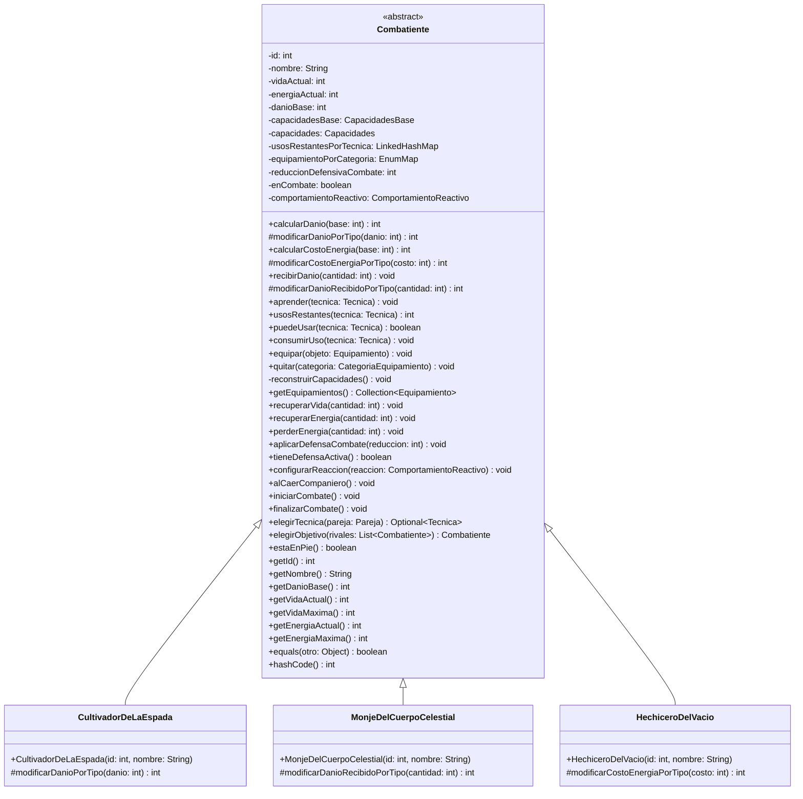

`id` y `nombre` son inmutables. `equals` y `hashCode` son finales y dependen exclusivamente del identificador, sin exigir la misma subclase. El estado mutable no participa de la igualdad. Las operaciones públicas de daño y costo aplican los pasos comunes y llaman a los métodos protegidos; los tipos solo redefinen su modificador. No se consulta el tipo con condicionales ni `instanceof`.

`puedeUsar` verifica conocimiento, estado en pie, usos y energía; la restricción del compañero se consulta en `Pareja`. El registro conserva el orden de aprendizaje y cinco usos propios por técnica durante el torneo. `aprender` no repone usos de una técnica conocida. No existe un reinicio de usos entre combates.

## 2. Técnicas compatibles con el ejemplo de `main`

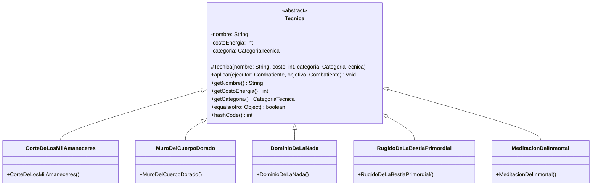

`Tecnica.aplicar` es abstracto. Las definiciones son inmutables; no conservan ejecutor, objetivo ni usos. Las ofensivas llaman a `objetivo.recibirDanio(ejecutor.calcularDanio(danioBase))`. Dominio también llama a `objetivo.perderEnergia(8)`; Muro a `ejecutor.aplicarDefensaCombate(6)` y Meditación a `ejecutor.recuperarVida(24)`.

`Combate` pasa al propio ejecutor como objetivo de defensa y recuperación. El pago de energía, consumo de usos, regla del compañero y acontecimientos se coordinan fuera de `aplicar`. La técnica no recibe un `Combate` ni publica eventos. Agregar una técnica implica una subclase con su categoría y efecto, sin modificar el torneo ni las técnicas existentes. Los nombres del catálogo son únicos y determinan igualdad y `hashCode` finales.

## 3. Definiciones de equipamiento

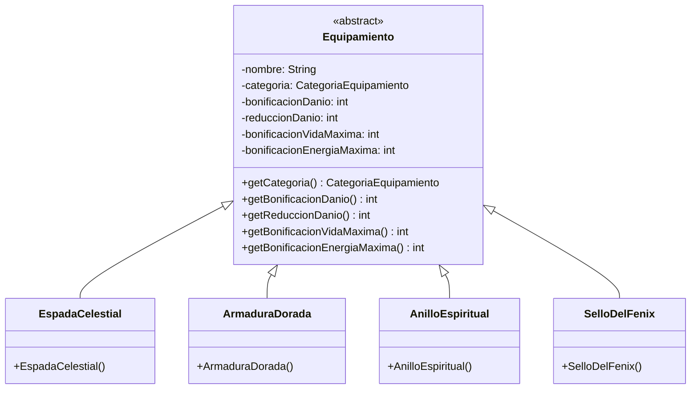

Cada subclase fija sus valores al construirse; los demás modificadores valen cero. Todos los campos son inmutables y las bonificaciones son no negativas. La definición no almacena un portador ni capacidades. Una escuela puede reutilizar `new EspadaCelestial()` para preparar varios combatientes sin compartir estado de combate.

## 4. Decorator de capacidades

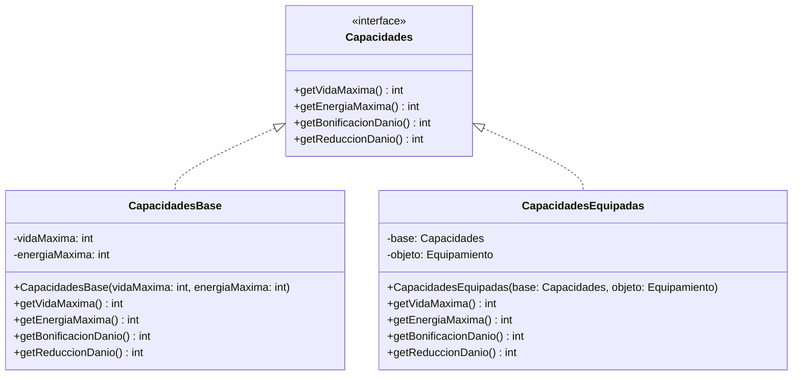

`CapacidadesBase` devuelve sus máximos y cero como bonificación de daño y reducción. El decorador implementa la misma interfaz y suma a cada consulta el modificador correspondiente de `objeto`. Ambos son inmutables. `base` es de tipo `Capacidades`, por lo que puede envolver el componente inicial u otro decorador.

`Combatiente.reconstruirCapacidades` parte siempre de `capacidadesBase`, crea un decorador por objeto y conserva la referencia exterior. La cadena se reconstruye tras validar el cambio. Vida actual, energía actual y usos permanecen en el mismo combatiente.

La siguiente vista separa las asociaciones del decorador de su jerarquía:

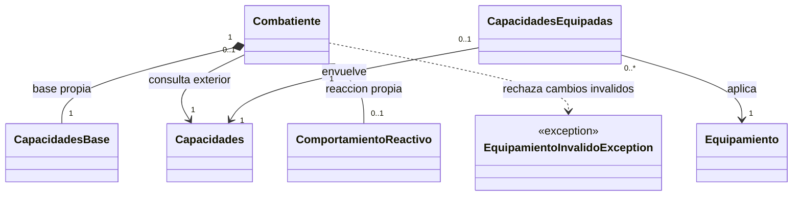

## 5. Bonus: reacción ante la caída del compañero

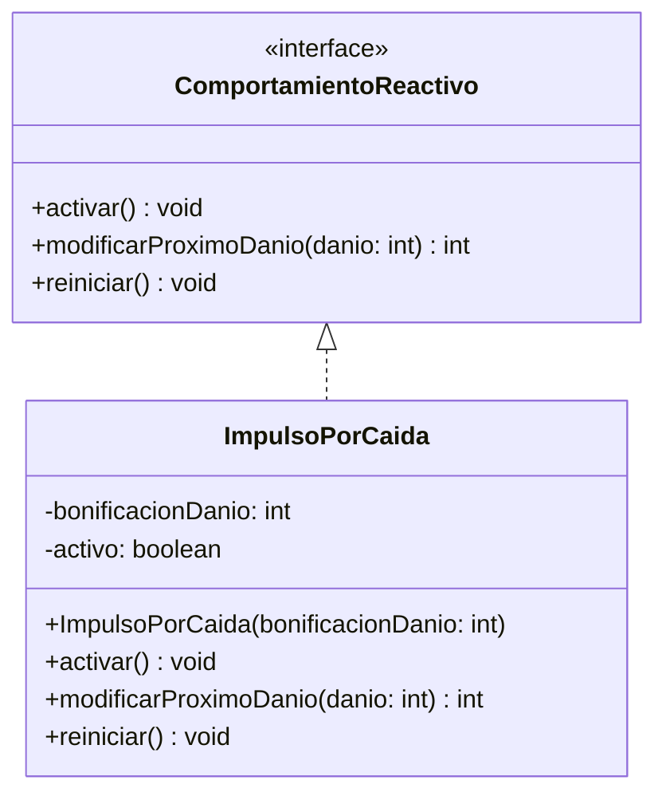

La estrategia tiene estado propio y no se comparte entre combatientes. `activar` deja pendiente un único impulso, sin acumular activaciones. `modificarProximoDanio` suma la bonificación si está activa y la consume; en otro caso devuelve el mismo daño. Solo se llama al calcular daño ofensivo. Recuperarse, defenderse o recibir daño no lo consume. Se reinicia al comenzar y al terminar el combate.

## 6. Creación, escuelas y composición del combatiente

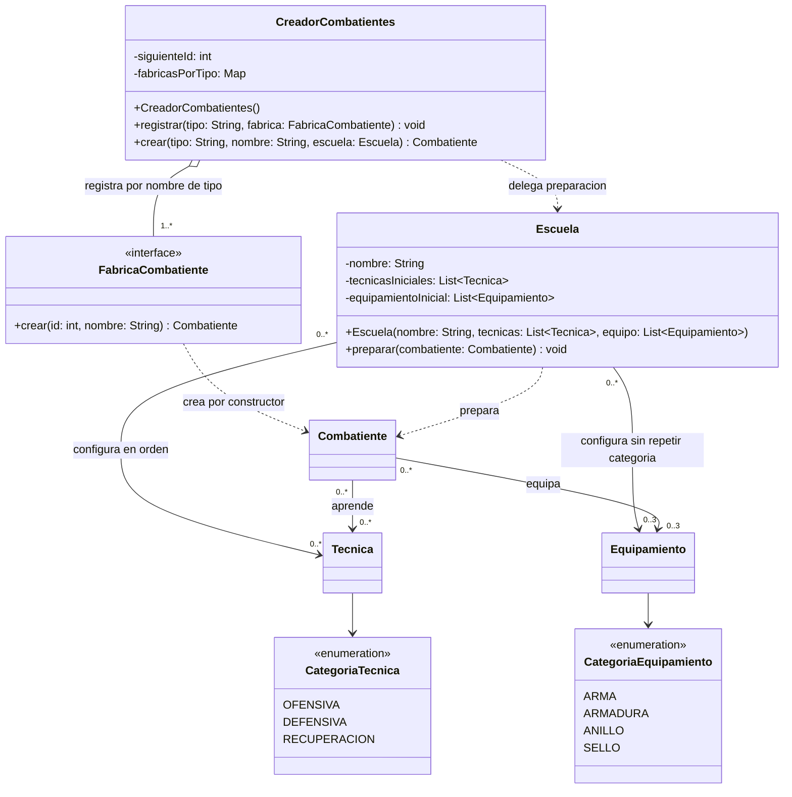

`Escuela` copia las listas y valida técnicas sin nombres repetidos y equipo válido. Sus listas no son modificables. Agregar una escuela consiste en construir otra configuración. La preparación de un combatiente nuevo aprende las técnicas en el orden indicado y equipa mediante las operaciones públicas.

El creador registra por defecto fábricas para los tres tipos iniciales; pueden implementarse con referencias a constructores compatibles con `FabricaCombatiente`. El primer id es 1 y los siguientes avanzan en orden de creación. Un tipo nuevo se incorpora registrando su fábrica. El algoritmo de `crear`, el torneo y las técnicas no inspeccionan clases concretas.

La cantidad `0..3` corresponde a los objetos de un combatiente, no a un límite global: una definición puede estar en muchos equipos. Cada cadena pertenece a un solo combatiente; cada componente tiene como máximo un decorador exterior inmediato. La referencia exterior de `Combatiente` apunta a la base sin equipo o al último decorador si tiene objetos.

## 7. Parejas, torneo, rondas y combate

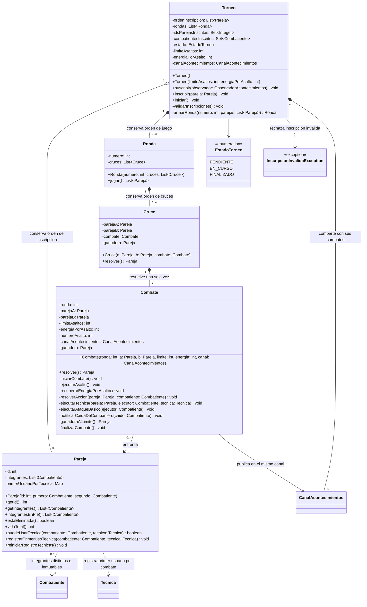

La pareja no crea ni destruye a sus dos integrantes. Su id y su lista son inmutables. El constructor rechaza ids no positivos, integrantes nulos o con el mismo id. El torneo rechaza inscripciones que repitan un integrante.

`inscribir` verifica id de pareja, ambos integrantes, capacidad máxima de ocho y estado pendiente antes de insertar nada. `iniciar` exige cuatro u ocho parejas y solo se ejecuta desde pendiente. Las rondas reciben las ganadoras en el orden de los cruces previos. El límite de asaltos es positivo y la recuperación de energía, no negativa.

`Cruce.resolver` y `Combate.resolver` devuelven el resultado ya obtenido si se repiten después de terminar; no vuelven a jugar ni a publicar eventos. Al finalizar se conservan vidas y energías finales para consulta, se limpian defensa y reacción, y se libera `enCombate`. Al comenzar el siguiente se restauran máximos y se reinicia el registro de pareja, sin tocar usos.

`Combate` controla turnos, validez de acciones, corte por eliminación y desempate. Comprueba transiciones de vida positiva a cero para publicar una sola eliminación por caído y activar la reacción una sola vez. El orden completo se fija en el README.

## 8. Acontecimientos inmutables

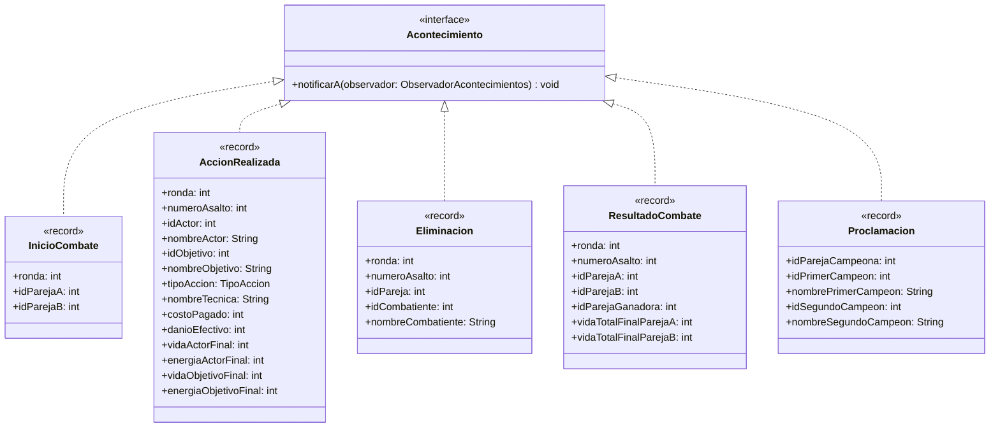

Los records almacenan valores, `String` y enumeraciones copiados al crear el evento, sin referencias a `Combatiente`, `Pareja` ni listas mutables. No incluyen la hora del sistema.

En `AccionRealizada`, `nombreTecnica` es la cadena vacía y `costoPagado` es cero para un básico. `danioEfectivo` es la pérdida real de vida por daño, limitada a la vida previa del objetivo, y vale cero para defensa y recuperación. En acciones sobre sí mismo coinciden los ids y estados finales de actor y objetivo. Los records generan `equals` y `hashCode`, de modo que historiales equivalentes se comparan directamente.

Cada `notificarA` llama al método correspondiente: `ResultadoCombate.notificarA(o)` llama a `o.recibirResultadoCombate(this)`. El canal no necesita `instanceof`, casts ni condicionales por tipo de evento.

## 9. Observadores, presentación y registro

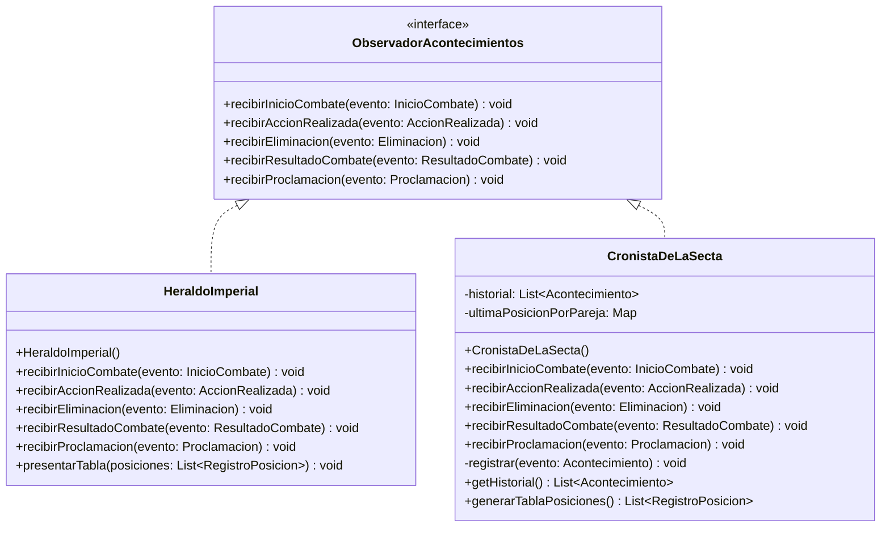

El Heraldo es la única clase que escribe por pantalla, incluido lo solicitado desde el `main`. El Cronista registra los acontecimientos en orden. Cada resultado actualiza la última posición de ambas parejas con los valores finales del evento. `getHistorial` devuelve `List.copyOf(historial)`; la tabla es una lista ordenada y no modificable. No se exponen las colecciones internas.

## 10. Integración de acontecimientos y aplicación

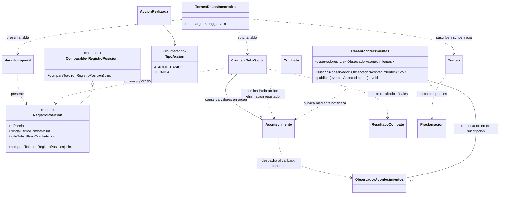

`publicar` recorre observadores en orden e invoca `evento.notificarA(observador)`. Nuevos interesados implementan la interfaz y se suscriben, sin cambiar el torneo. Los callbacks observan y presentan, sin modificar el dominio. Se rechazan suscripciones nulas o de la misma instancia repetida. Se crea un Cronista nuevo para cada torneo independiente.

`RegistroPosicion` implementa `Comparable<RegistroPosicion>` con ronda descendente, vida descendente e id ascendente. Los enteros se comparan sin restar sus valores, para evitar desbordamientos. La final cuenta como última ronda jugada para ambas finalistas.

## Colecciones y responsabilidades

| Propietario | Colección Java | Motivo |
| --- | --- | --- |
| `Combatiente` | `LinkedHashMap<Tecnica, Integer>` | Usos propios y orden determinista |
| `Combatiente` | `EnumMap<CategoriaEquipamiento, Equipamiento>` | Una entrada por categoría y reconstrucción ordenada |
| `Escuela` | `List<Tecnica>` y `List<Equipamiento>` no modificables | Configuración ordenada y compartible |
| `CreadorCombatientes` | `Map<String, FabricaCombatiente>` | Resolver tipos sin consultar clases |
| `Pareja` | `List<Combatiente>` no modificable, de tamaño dos | Integrantes estables; se ordenan por id al actuar |
| `Pareja` | `Map<Tecnica, Combatiente>` | Primer usuario en el combate actual |
| `Torneo` | `List<Pareja>`, `List<Ronda>` | Orden de inscripción y rondas |
| `Torneo` | `Set<Integer>`, `Set<Combatiente>` | Rechazar duplicados por identidad |
| `Ronda` | `List<Cruce>` | Orden de cruces y ganadoras |
| `CanalAcontecimientos` | `List<ObservadorAcontecimientos>` | Orden de notificación |
| `CronistaDeLaSecta` | `List<Acontecimiento>` | Historial cronológico sin tiempos externos |
| `CronistaDeLaSecta` | `Map<Integer, RegistroPosicion>` | Último resultado de cada pareja |

Daño, costo, recuperación, drenaje y bonificaciones son no negativos. Los ids, máximos base y límite de asaltos son positivos. Argumentos nulos o cantidades inválidas se rechazan antes de modificar estado; equipo e inscripción usan sus excepciones específicas. `perderEnergia` limita el saldo a cero y no autoriza una técnica sin energía suficiente.

## Contratos y pruebas necesarias

Esta matriz especifica pruebas futuras; no representa pruebas implementadas ni ejecutadas. Los casos generales pueden dividirse en pruebas más específicas para cubrir todas las reglas de las secciones 4, 5 y 6 de la consigna.

| Área | Casos que debe cubrir JUnit 5 |
| --- | --- |
| Identidad | Mismo id con distinto nombre o tipo: igualdad y mismo hash; cambiar estado no altera identidad |
| Técnicas | Misma técnica con daño distinto por ejecutor; cinco efectos; técnica nueva sin cambiar las existentes |
| Usos y energía | Sin conocimiento, energía o usos no cambia nada; cinco usos por técnica y combatiente; compartir definición no comparte usos; reaprender no repone |
| Escuelas y creación | Cada escuela prepara los tres tipos; orden preservado; ids consecutivos; tipo desconocido rechazado; no comparte estado mutable |
| Equipamiento | Hasta tres objetos; cuarto, categoría repetida y cambios durante combate rechazados sin cambios; consulta no modificable; quitar categoría vacía rechazado |
| Decorator | Efectos acumulados; quitar conserva los otros; reconstruir no duplica bonificaciones; cadenas independientes con definiciones compartidas |
| Máximos | Equipar no recarga; quitar recorta vida o energía si exceden el máximo; recuperación limitada a máximos equipados |
| Parejas | Dos integrantes distintos; ids válidos; lista inmutable; vida total y caído con aporte cero |
| Inscripciones | Pareja o integrante duplicados, cantidad inválida y estado no pendiente rechazados; ninguna inserción parcial |
| Rondas y torneo | Cuatro y ocho parejas; orden inicial y de ganadoras; una campeona; repetir resolución no duplica eventos |
| Turnos y caídas | Orden por ids; una acción por integrante en pie y asalto; caído no actúa ni es objetivo; fin inmediato al eliminar pareja |
| Elección de acción | Recuperación, defensa y ofensiva entre las posibles; mayor cantidad de usos; empate escolar; descarte por energía, usos y compañero; básico gratuito e ilimitado |
| Objetivos | Rival en pie con menos vida y desempate por id; defensa y recuperación sobre ejecutor |
| Compañero | Bloqueo con usos y en pie, aun sin energía; liberación al caer o agotar; básico no registra; reinicio en combate siguiente |
| Ciclo de combate | Restauración de máximos, incluidos caídos anteriores; usos y equipo conservados; recuperación por asalto solo en pie; defensa hasta el final; sin resurrección durante combate |
| Límite y determinismo | Límite exacto; mayor vida y desempate por id; dos torneos desde el mismo estado dan campeona e historial iguales |
| Acontecimientos | Inicio, acción, eliminación, resultado y proclamación en orden; ambas vidas finales guardadas; cambios posteriores no alteran eventos; observador nuevo sin cambiar torneo |
| Cronista y Heraldo | Ronda descendente, vida descendente e id ascendente; solo Heraldo imprime; pruebas consultan estado e historial |
| Bonus reactivo | Una activación por caída; defensa y recuperación no consumen; siguiente ataque consume una vez; limpieza final aunque quede pendiente |

Para completar la entrega se deben implementar las clases, ejecutar las pruebas y preparar el informe y la defensa indicados en la consigna.

